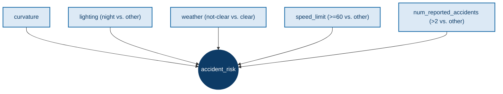
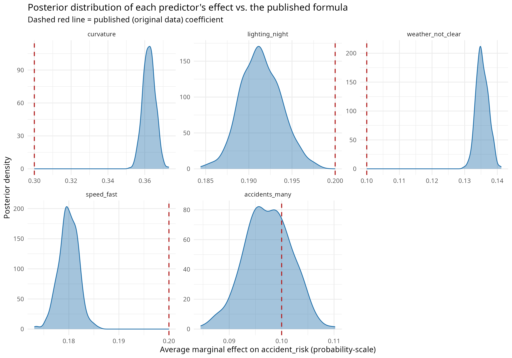
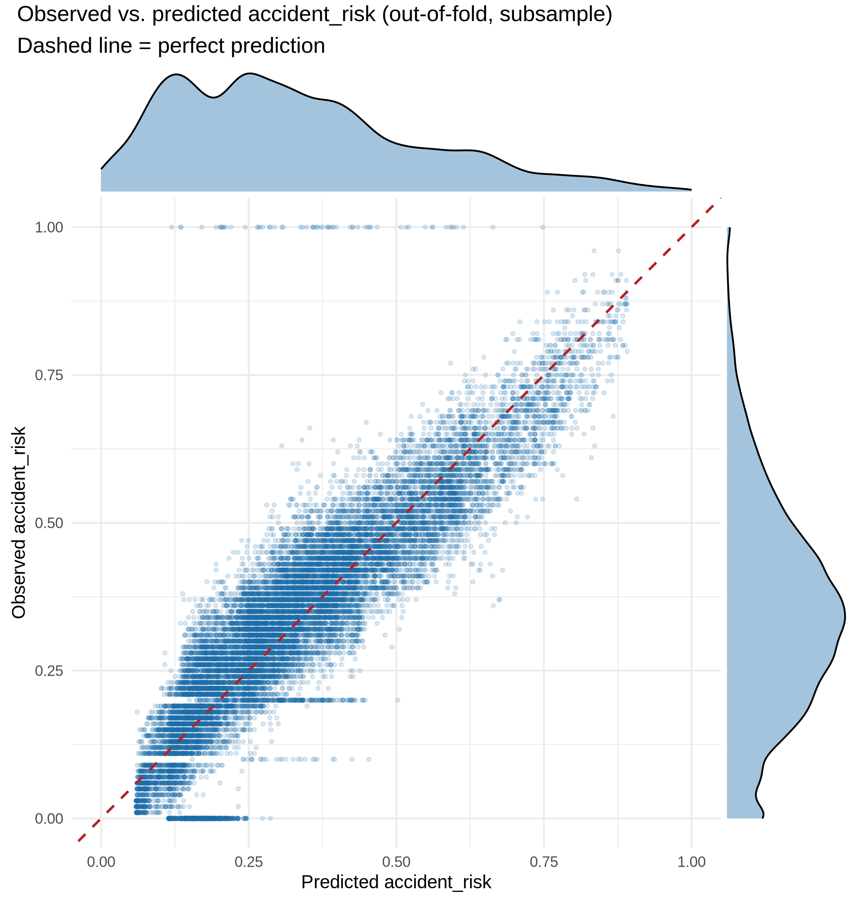

# Predicting Road Accident Risk — Bayesian Beta regression

Kaggle competition: https://www.kaggle.com/competitions/playground-series-s5e10

## 1. Background

This project is part of the **Bayesian Kaggle Challenge**, a series of independent projects solved by using only **Bayesian Statistics**, where we focus on inference without giving up too much predictability.

This entry tackles [Predicting Road Accident Risk](https://www.kaggle.com/competitions/playground-series-s5e10): given a road segment's attributes (curvature, speed limit, lighting, weather, number of lanes, road type, whether it's a public road, whether signs are present, time of day, holiday/school-season flags, and its number of previously reported accidents), predict `accident_risk`, a continuous score in [0, 1]. Training data covers 517,754 rows, no missing values; submissions are scored by RMSE against 172,585 held-out rows.

A rare gift for this kind of project: this competition's data is a synthetic resynthesis (via a deep learning model) of an existing "Simulated Roads Accident" dataset whose *exact generative formula* has been published by another Kaggle user. That gave us a genuine bibliography to build a causal DAG from, rather than domain reasoning alone — and a chance to test empirically whether the resynthesis preserved that structure.

The rest of this document walks through the exploratory findings that led us to that formula, the DAG and variable screening it motivated, the model itself, how it was validated, and the final results.

## 2. Exploratory findings that shaped the design

The target has a telling shape: `accident_risk` is continuous over [0, 1], but with small point masses at exactly 0 (608 rows, 0.12%) and exactly 1 (61 rows, 0.01%).

A top-voted public notebook gave the *original* (pre-resynthesis) dataset's exact structural equation:

```
latent_risk = 0.3·curvature + 0.2·I(lighting == "night") + 0.1·I(weather != "clear")
              + 0.2·I(speed_limit >= 60) + 0.1·I(num_reported_accidents > 2)
accident_risk = clip(latent_risk + N(0, sigma = 0.05), 0, 1)
```

An OLS fit of `accident_risk` on exactly these 5 terms gave coefficients essentially matching the published ones:

| Term | Published (original data) | Refit here (this competition's train.csv) |
|---|---|---|
| `curvature` | 0.3 | 0.305 |
| `lighting == night` | 0.2 | 0.190 |
| `weather != clear` | 0.1 | 0.093 |
| `speed_limit >= 60` | 0.2 | 0.186 |
| `num_reported_accidents > 2` | 0.1 | 0.097 |

This 5-term OLS fit alone gets RMSE **0.058** on the full training set — within ~4% (relative) of the ~0.056 RMSE ceiling that heavy GBM ensembles achieve on the public leaderboard with target encoding and external-data augmentation. This means taht the deep-learning resynthesis preserved the original causal structure almost unchanged, giving us a bibliography-backed, empirically-confirmed structure to build around rather than a DAG from domain reasoning alone.

## 3. Causal structure and predictor selection

Since the bibliography is explicit about which 5 variables are direct causes, this DAG is a flat, single-layer structure — no mediators or colliders to reason through, unlike some of our other projects:



The 7 remaining raw columns aren't in the published formula, anyways, we wanted to check whether they carry any real information to predict the target feature. For each, we compared a 5-term "known" OLS model against the same model plus that one candidate, and comparing the effect size and ignoring the p-values (several of which were significant given the large number of observations inclded: n = 517,754). We set an arbitrary threshold 20% of the highest known-formula coefficient effect (~0.019) for that new feature to be kept. All 7 were dropped.

| Candidate | RMSE delta | p-value | Max \|coefficient\| | Verdict |
|---|---|---|---|---|
| `road_type` | 0.0000010 | 1.6×10⁻⁴ | 0.0006 | drop |
| `num_lanes` | 0.0000054 | 7.7×10⁻²¹ | 0.0020 | drop |
| `road_signs_present` | 0.0000010 | 3.5×10⁻⁵ | 0.0007 | drop |
| `public_road` | 0.0000001 | 0.138 | 0.0002 | drop |
| `time_of_day` | 0.0000050 | 6.6×10⁻²⁰ | 0.0011 | drop |
| `holiday` | 0.0000001 | 0.129 | 0.0002 | drop |
| `school_season` | 0.00000002 | 0.580 | 0.0001 | drop |

We also tested whether the published formula's functional-form choices still hold in the resynthesized data:

- `speed_limit`/`num_reported_accidents` as continuous terms fit far worse (RMSE 0.0735 vs. 0.058) than as thresholded indicators, and a fully flexible per-level encoding barely improved on the threshold form (RMSE 0.05803 vs. 0.05805), confirming the published thresholds (`>=60`, `>2`) transferred essentially intact.
- `lighting`/`weather` as full 3-level factors showed `dim` behaving just like `daylight` (coefficient 0.002) and `rainy`/`foggy` behaving identically to each other (0.093 vs. 0.093). Confirming the published binary collapse ("night vs. other", "not-clear vs. clear") is the right encoding, not an oversimplification.

## 4. Model

The proposed model is a Beta regression defined as follows:

$$\text{accident\_risk}_i \sim \text{Beta}(\mu_i, \phi)$$

$$\text{logit}(\mu_i) = \beta_0 + \beta_1\,\text{curvature}_i + \beta_2\,\text{lighting\_night}_i + \beta_3\,\text{weather\_not\_clear}_i + \beta_4\,\text{speed\_fast}_i + \beta_5\,\text{accidents\_many}_i$$

With only 5 predictors and a simple base formula, using the entirety of the 517,754 rows is an overkill, plus training the model with all the data would take forever in my modest computer. I decided to on a decile-stratified subsample of 20,000 rows. The remaining 497,754 rows were used as a heldout dataset.

Predictors were not standardized to keep them on their raw scale, making it easier to compare them directly against the published formula.

### Priors

Weakly informative, centered loosely on the published formula's coefficientsbut on the logit scale:

$$\beta_0 \sim \mathcal{N}(-2,\ 2) \qquad \beta_{\text{curvature}},\ \beta_{\text{lighting\_night}},\ \beta_{\text{weather\_not\_clear}},\ \beta_{\text{speed\_fast}},\ \beta_{\text{accidents\_many}} \sim \mathcal{N}(0,\ 2)$$

$$\phi \sim \text{Gamma}(0.01,\ 0.01)$$

### Validation: 5-fold CV within the subsample, then a full-data honesty check

We implemented a 5-fold cross-validation to check the predictive performance stability in the subsample. Separately, the subsample-fitted model's predictions are checked against the ~497,754 held-out rows for a final performance estimation.

## 5. Results

### Cross-validated performance

| Fold | RMSE | Max R-hat | Divergences |
|---|---|---|---|
| 1 | 0.0791 | 1.0005 | 0 |
| 2 | 0.0825 | 1.0009 | 0 |
| 3 | 0.0798 | 1.0019 | 0 |
| 4 | 0.0799 | 1.0013 | 0 |
| 5 | 0.0836 | 1.0024 | 0 |
| **Mean ± SD** | **0.0810 ± 0.0019** | | |

R-hat and divergences checks suggest that the posteriors are clean and trustworthy. Nevertheless, the CV results show a worst performance compared to the heldout prediction:

| | RMSE |
|---|---|
| Subsample 5-fold CV | 0.0810 |
| Full-data holdout (497,754 rows never used in fitting) | 0.0680 |

The full-data (predicting heldout) number is *better* than the CV estimate. This may be explained because of the the decile-stratified fold creation, deliberately over-representing extreme (and rare) rows that are inherently harder to predict. The full-data check (on a truly representative sample), is a more honest estimate of the model performance.

### Coefficients



The Average Marginal Effects (AME) were sampled and compared to the parameters in the published formula:

| Predictor | Posterior AME | 95% CrI | Published (original data) |
|---|---|---|---|
| `curvature` | 0.362 | [0.356, 0.369] | 0.3 |
| `lighting_night` | 0.191 | [0.187, 0.196] | 0.2 |
| `weather_not_clear` | 0.135 | [0.132, 0.139] | 0.1 |
| `speed_fast` | 0.180 | [0.176, 0.184] | 0.2 |
| `accidents_many` | 0.097 | [0.088, 0.105] | 0.1 |

All 5 effects are positive and aligned with the published formula, though the credible intervals are tight enough (n = 20,000) that most don't technically contain the published value, suggesting a small but detectable shift in the resynthesized data's structure, not just noise. Posterior `phi` (Beta precision) is 7.84 [7.69, 7.99].

### Calibration and limitations



Out-of-fold predictions hug the perfect-fit diagonal closely across most of the range. The marginal densities on each axis show the predicted distribution is a bit more concentrated than the more spread-out, skewed observed distribution, but the bulk of the point cloud tracks the dashed "perfect prediction" line well.

The two places this model is measurably weak are at the exact two boundaries:

- For the 608 rows with true `accident_risk = 0` (0.12% of the training data), the mean prediction is **0.168**: the model **overpredicts** risk for these.
- For the 61 rows with true `accident_risk = 1` (0.01% of the training data), the mean prediction is only **0.379**: the model **underpredicts** risk for these.

Beta regression's logit link doesn't have a boundary-clipping mechanism, so pushing predictions all the way to either extreme for rare, genuinely boundary covariate combinations is not natural. A good alternative is to use a  zero-one-inflated Beta model, giving the exact-0 and exact-1 outcomes their own dedicated probability parameters instead of routing them through the same continuous mean function. 

## 6. Kaggle result

| | Public score | Private score |
|---|---|---|
| This entry | 0.06864 | 0.06843 |
| Leaderboard, 1st place | 0.05563 | 0.05563 |

Both of this entry's numbers line up closely with the internal full-data honesty check (0.0680), showing that the subsampling shortcut and the heldout check together gave an accurate, trustworthy estimate of the real performance before ever touching the leaderboard. This sits about 20–23% (relative) above the ~0.056 RMSE that heavy GBM ensembles with target encoding and external-data augmentation achieve on the public leaderboard.

## Repository layout

- `src/features.R` — the 4 engineered binary predictors and decile-stratified (boundary-guaranteed) subsampling
- `src/metrics.R` — hand-written RMSE and the Beta boundary-squeeze transform
- `src/stage1_dag_screening.R` — the DAG variable screening (§3), run on the full 517,754-row training set
- `src/build_subsample.R` — builds the persisted 20,000-row modeling subsample
- `src/model_spec.R` — Beta formula/family/priors
- `src/prior_predictive_check.R`, `src/fit_cv.R`, `src/fit_final.R` — prior check, 5-fold CV, final fit
- `src/check_full_data_honesty.R` — the full-data honesty check (§5)
- `src/check_calibration.R`, `src/report_inference.R` — calibration/boundary-mass check, posterior AME reporting
- `src/predict_test.R` — generates `data/processed/submission.csv`
- `tables_figures/` — all figures and summary tables referenced above
